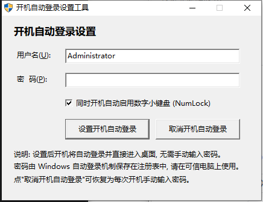

# Windows 开机自动登录设置工具

一个纯 C + Win32 API 编写的轻量 GUI 小工具，用来一键配置 Windows 开机自动登录（免密码进桌面），
并可同时开启开机数字小键盘（NumLock），也可随时一键取消。

无第三方依赖、无运行时环境要求，单个 exe 即可运行（约 100 KB）。

## 功能特性

- **一键设置开机自动登录**：输入用户名 + 密码，下次开机自动进入桌面，不再需要手动输入密码
- **一键取消**：恢复为每次开机手动输入密码，并清除注册表中明文保存的密码
- **自动启用数字小键盘**：开机时自动点亮 NumLock（登录界面 + 进入桌面后均生效）
- **自动提权**：程序清单内嵌 `requireAdministrator`，启动即弹 UAC，无需手动右键"以管理员身份运行"
- **原生 Win32 界面**：微软雅黑字体、现代控件主题、Tab / 回车 / 快捷键（Alt+U、Alt+P）均可用
- **兼容性处理**：
  - 32 位程序写 `HKLM` 时使用 `KEY_WOW64_64KEY`，避免被重定向到 `Wow6432Node` 导致设置无效
  - 自动关闭 Win10/11 的"仅允许 Windows Hello 登录"限制，解决新版系统强制要求密码的问题
  - 本地账户自动补写 `DefaultDomainName`，微软账户（邮箱）则跳过，避免域不匹配

## 界面截图



## 使用方法

1. 下载 `AutoLogin.exe`，双击运行（会弹出 UAC 提权确认，点"是"）
2. 用户名已自动填为当前登录账户，按需修改
3. 输入该账户的登录密码
4. 按需勾选"同时开机自动启用数字小键盘 (NumLock)"
5. 点击 **设置开机自动登录**，看到"设置成功"即完成
6. 下次开机将自动登录并直接进入桌面

需要撤销时，点击 **取消开机自动登录** 即可。

## 实现原理

程序通过写入 Windows 官方的自动登录注册表项实现，不修改系统文件、不安装服务、不常驻后台。

### 设置时写入

| 注册表位置 | 键名 | 值 | 作用 |
|---|---|---|---|
| `HKLM\SOFTWARE\Microsoft\Windows NT\CurrentVersion\Winlogon` | `AutoAdminLogon` | `1` | 开启自动登录 |
| 同上 | `DefaultUserName` | 用户名 | 自动登录账户 |
| 同上 | `DefaultPassword` | 密码 | 自动输入的密码 |
| 同上 | `DefaultDomainName` | 计算机名 | 本地账户所属域 |
| `HKLM\...\PasswordLess\Device` | `DevicePasswordLessBuildVersion` | `0` | 关闭 Win10/11 的 Windows Hello 强制限制 |
| `HKU\.DEFAULT\Control Panel\Keyboard` | `InitialKeyboardIndicators` | `2147483650` | 登录界面自动点亮 NumLock |
| `HKCU\Control Panel\Keyboard` | `InitialKeyboardIndicators` | `2` | 进入桌面后保持 NumLock 开启 |

### 取消时

- `AutoAdminLogon` 置为 `0`
- 删除 `DefaultPassword`（清除明文密码）
- 若勾选了小键盘选项，一并删除上表两处 `InitialKeyboardIndicators`

## 编译

需要 MinGW-w64（gcc + windres）。在项目目录执行：

```bat
build.bat
```

或手动执行：

```bat
windres app.rc -O coff -o appres.o
windres app.rc -O coff -o local-crt\default-manifest.o
gcc -mwindows -O2 -Wall -Wextra "-Blocal-crt/" -o AutoLogin.exe autologin.c appres.o -lshell32 -ladvapi32
```

> `-Blocal-crt/` 用于让 gcc 跳过 CRT 自带的 `default-manifest.o`，改用 `app.rc` 中嵌入的
> `requireAdministrator` + `Common-Controls v6` 清单，否则会出现
> `ld: .rsrc merge failure: multiple non-default manifests` 错误。

## 安全提示

- 该机制会把密码以**明文**保存在注册表中，这是 Windows 官方设计如此。请仅在**可信、物理安全**的电脑上使用。
- 不建议在公共电脑、多人共用电脑或存放敏感数据的电脑上开启自动登录。
- 更安全的选择是使用 Windows Hello（PIN / 指纹 / 人脸）替代裸密码。

## 已知限制

- 仅支持**本地账户**。微软账户（Outlook 邮箱登录）微软自身不支持该注册表方式免密登录。
- 若账户密码为空，`DefaultPassword` 可留空。
- 系统启用 BitLocker / 其他磁盘加密时，开机仍可能需要先解锁磁盘，这与本工具无关。

## 项目结构

```
autologin.c     主程序（Win32 GUI + 注册表操作）
app.manifest    应用程序清单（管理员权限 + 控件主题）
app.rc          资源脚本（嵌入清单）
build.bat       一键编译脚本
AutoLogin.exe   编译产物
```

## License

[MIT](LICENSE)
